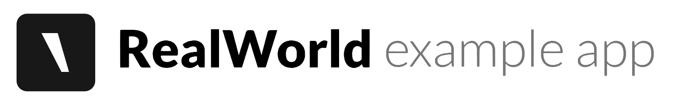

# 

> ### [Backtick](https://backtickjs.dev) + [Solid](https://www.solidjs.com) codebase containing real world examples (CRUD, auth, advanced patterns, etc) that adheres to the [RealWorld](https://docs.realworld.show/) spec and API.

### [Demo](https://realworld.backtickjs.dev)&nbsp;&nbsp;&nbsp;&nbsp;[RealWorld](https://github.com/realworld-apps/realworld)

This codebase was created to demonstrate a fully fledged application built with Backtick and Solid including CRUD operations, authentication, routing, pagination, and more.

For more information on how this works with other frontends/backends, head over to the [RealWorld](https://github.com/realworld-apps/realworld) repo.

## Running locally

```sh
git clone https://github.com/backtickjs/backtick-solid-realworld-example-app.git
cd backtick-solid-realworld-example-app
npm run setup  # Init submodules + install dependencies
npm start
```

To build and start in prod mode:

```sh
npm run build
npm run preview
```
